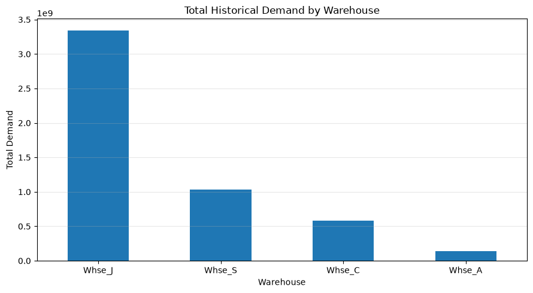
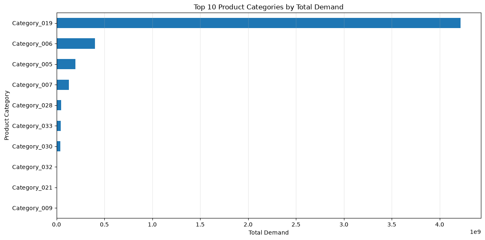
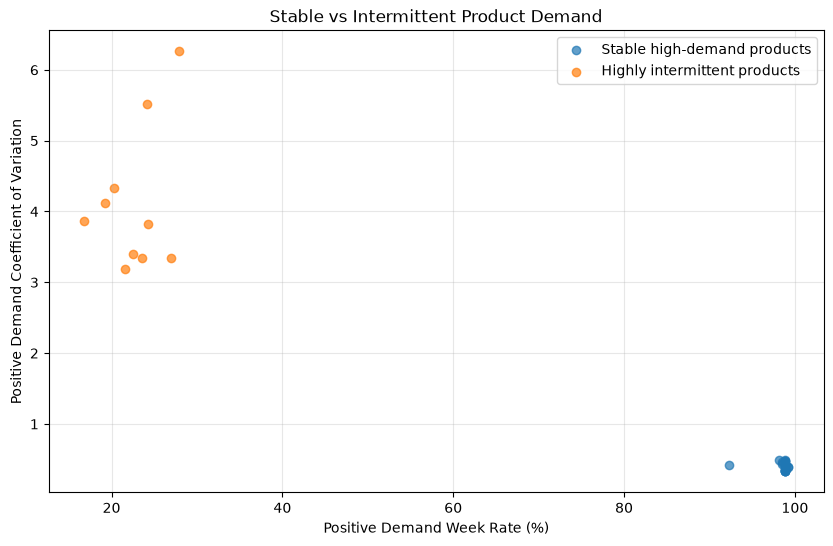
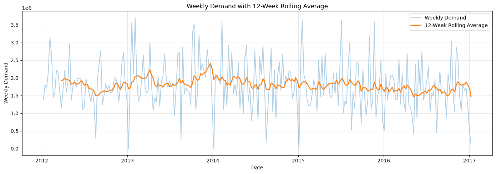
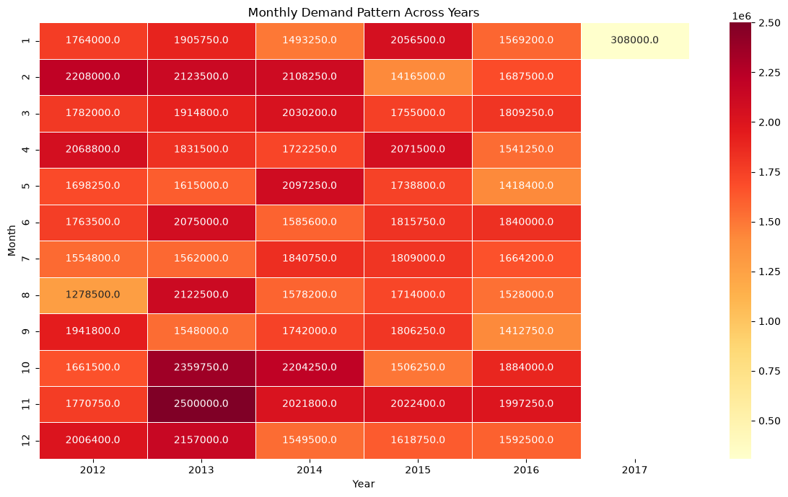
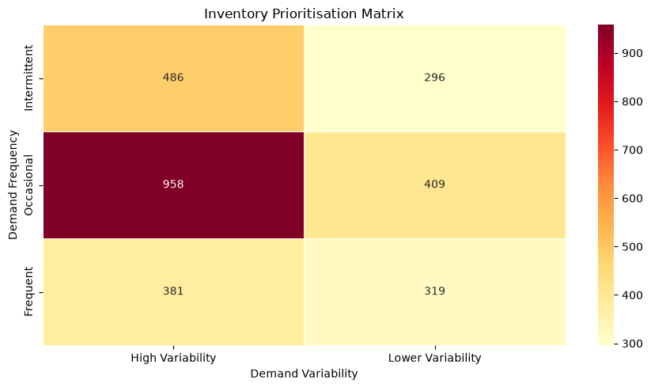
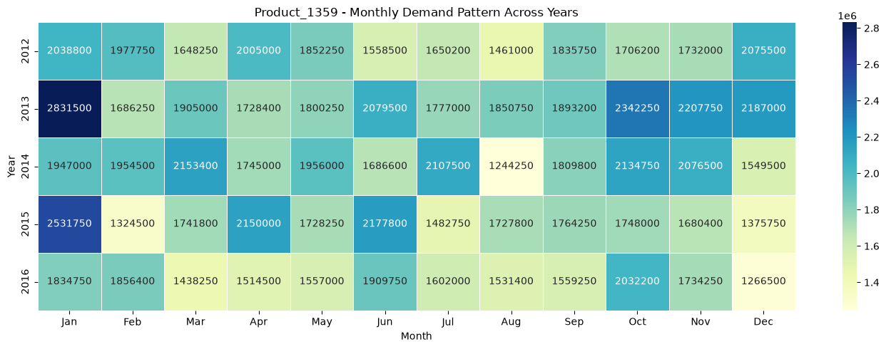
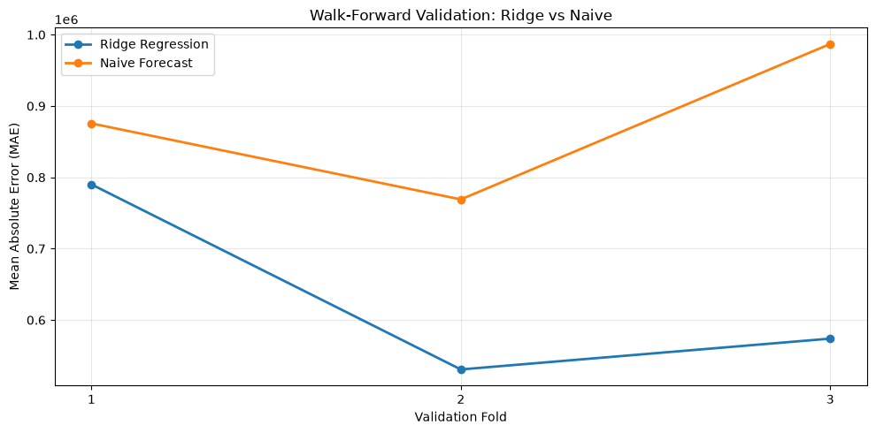
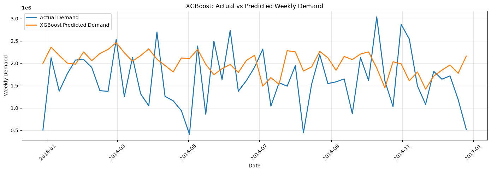
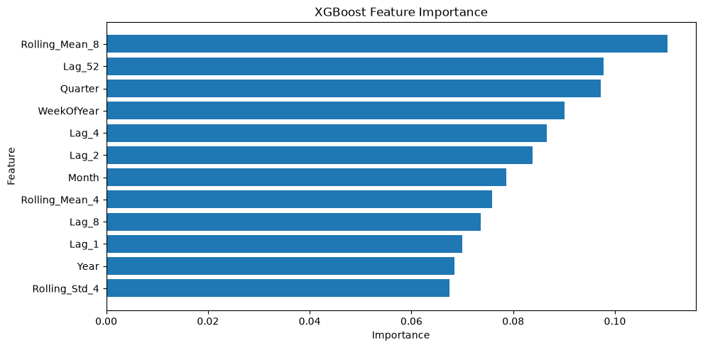

# Demand Forecasting and Inventory Planning Intelligence

**From historical product demand to inventory planning insights and forecasting evaluation.**

An analytical project exploring how demand patterns differ across products and warehouses, how inventory reviews can be prioritised, and how forecasting models perform when tested against historical weekly demand.

---

## The Business Challenge

Inventory teams face two connected decisions:

1. **Where should inventory planning attention be focused?** Demand differs across warehouses and products. Some products have frequent demand, while others experience long periods of inactivity followed by large spikes.
2. **How reliable are demand forecasts?** Forecasting errors can affect replenishment decisions, working capital and stock availability.

This project investigates both questions using historical product demand data. It combines exploratory analysis, demand-pattern classification, inventory prioritisation and time-series forecasting evaluation.

## Project Structure

| Notebook | Focus |
|---|---|
| [Demand_Forecasting.ipynb](./Demand_Forecasting.ipynb) | Weekly demand preparation, statistical forecasting, machine learning experiments and model evaluation |
| [Demand_Forecasting_Inventory_Intelligence.ipynb](./Demand_Forecasting_Inventory_Intelligence.ipynb) | Warehouse and product demand analysis, demand variability, seasonality and inventory prioritisation |

## Part I — Understanding Inventory Demand

### 1. Demand Across Warehouses

The analysis covers four warehouses: Whse_A, Whse_C, Whse_J and Whse_S.

Whse_J contributed approximately **65.6% of total recorded net demand**, followed by Whse_S (20.3%), Whse_C (11.4%) and Whse_A (2.8%).



### 2. Demand Concentration Across Product Categories

The dataset contains 33 product categories. Category_019 contributed approximately **82.7% of total recorded demand**, indicating a substantial concentration of demand in one category.



### 3. Stable vs Intermittent Demand

Products were examined using demand frequency and variability rather than average demand alone.

The analysis distinguished products with frequent, comparatively consistent positive demand from products with infrequent and highly variable demand.



### 4. Product-Level Demand Behaviour

Product_1359 at Whse_J had the highest average weekly demand and standard deviation among the product–warehouse combinations examined.

Its 12-week rolling average generally fluctuated between approximately 1.5 million and 2.1 million units. However, actual weekly demand remained volatile.



### 5. Seasonality Investigation

Monthly and weekly demand patterns were examined to identify recurring seasonal behaviour.

Monthly demand varied considerably between years. No strong, consistent annual seasonal pattern was identified for the selected product series.



### 6. Inventory Prioritisation

Demand frequency and variability were combined to identify product–warehouse combinations that may deserve closer inventory review.

Whse_J accounted for 51.25% of the occasional-demand, high-variability combinations identified in the analysis.



---

## Part II — Forecasting Experiments

### Forecasting Approach

The forecasting notebook transformed historical transaction records into a weekly demand series and evaluated statistical and machine-learning approaches.

The experiments included:

- Naive and seasonal naive forecasting
- Moving averages
- Simple Exponential Smoothing
- Holt's Linear Trend
- Holt-Winters
- Ridge Regression
- Autoregressive models
- Random Forest
- XGBoost

Time-ordered training, validation and testing periods were used for model evaluation. Walk-forward validation was also explored.

### Weekly Demand Patterns



### Walk-Forward Validation



### XGBoost Forecast Evaluation



### Feature Importance



---

## Model Evaluation

The final test-period comparison reported the following results:

| Model | MAE | RMSE | MAPE | R² |
|---|---:|---:|---:|---:|
| **Ridge Regression** | **499,931.45** | **631,992.24** | **42.18%** | **-0.0274** |
| AR(4) | 566,391.34 | 709,251.63 | 58.02% | -0.2940 |
| XGBoost | 610,962.36 | 754,161.42 | 60.10% | -0.4631 |
| Random Forest | 664,921.09 | 780,968.88 | 64.23% | -0.5689 |
| 4-Week Moving Average | 572,518.87 | 693,385.54 | 47.89% | -0.2368 |
| Naive Forecast | 753,471.70 | 929,584.77 | 54.88% | -1.2229 |

Ridge Regression recorded the lowest MAE among the evaluated models. Its MAE was approximately 33.65% lower than the naive baseline.

**However, the negative R² score is important:** the model did not outperform the test-period mean as an explanatory baseline under this metric. The results indicate that forecasting performance remains limited and requires further improvement.

## Business Interpretation

The test-period average weekly demand was approximately **1,638,283**, while the median was **1,605,000**.

The Ridge Regression MAE of approximately 499,931 represents around **30.52% of average weekly demand**.

These findings suggest:

- Inventory attention should account for differences between warehouses and product categories.
- Demand frequency and demand variability should be considered separately.
- High-demand products can still have substantial short-term fluctuations.
- Historical seasonality should not automatically be assumed to repeat consistently.
- Forecasts should be interpreted alongside their prediction errors rather than used as exact replenishment quantities.

## Recommendations

1. Prioritise detailed demand reviews for warehouses with large concentrations of high-variability products.
2. Monitor intermittent-demand products separately from stable, frequently purchased products.
3. Investigate unusual demand spikes, negative demand records and periods with no recorded transactions.
4. Improve forecasting through additional features, alternative modelling approaches and more robust validation.
5. Combine demand forecasts with inventory balances, supplier lead times, ordering costs and service-level targets before making replenishment decisions.

## Limitations & Further Work

- Historical transactions may not represent actual customer demand when stock was unavailable.
- Zero-demand observations do not necessarily mean that no demand existed.
- Negative demand may represent returns or adjustments; its exact operational meaning is not established.
- Three missing weekly observations were interpolated in the forecasting workflow.
- The test period was examined during model development, which may affect the independence of the final evaluation.
- Negative R² values indicate that the evaluated forecasting models have not yet achieved satisfactory predictive performance.
- Inventory balances, supplier lead times, stockout records and ordering costs were not available to calculate optimal stock quantities.

Further work should investigate intermittent-demand forecasting, improve validation discipline, incorporate inventory and lead-time information, and evaluate the operational value of forecast-based replenishment.

## Tools & Technologies

Python · Pandas · NumPy · Matplotlib · Seaborn · Scikit-learn · XGBoost · Jupyter Notebook

## Project Files

| File | Purpose |
|---|---|
| [Demand_Forecasting_Inventory_Intelligence.ipynb](./Demand_Forecasting_Inventory_Intelligence.ipynb) | Exploratory demand analysis and inventory planning intelligence |
| [Demand_Forecasting.ipynb](./Demand_Forecasting.ipynb) | Statistical and machine-learning forecasting experiments |
| [Visualisations](./images/) | Project charts and analytical visualisations |

## Running the Project

1. Clone or download this repository.
2. Install the required Python libraries.
3. Obtain the original historical product demand dataset.
4. Place the dataset in the location expected by the notebooks, or update the file path.
5. Open the notebooks in Jupyter Notebook or JupyterLab.
6. Run the cells in sequence.

Install the main dependencies:

```bash
pip install pandas numpy matplotlib seaborn scikit-learn xgboost statsmodels jupyter
```

---

**Project takeaway:** Better inventory planning requires more than a single demand forecast. It requires understanding where demand occurs, how frequently it occurs, how variable it is, and how much confidence decision-makers should place in the model's predictions.
